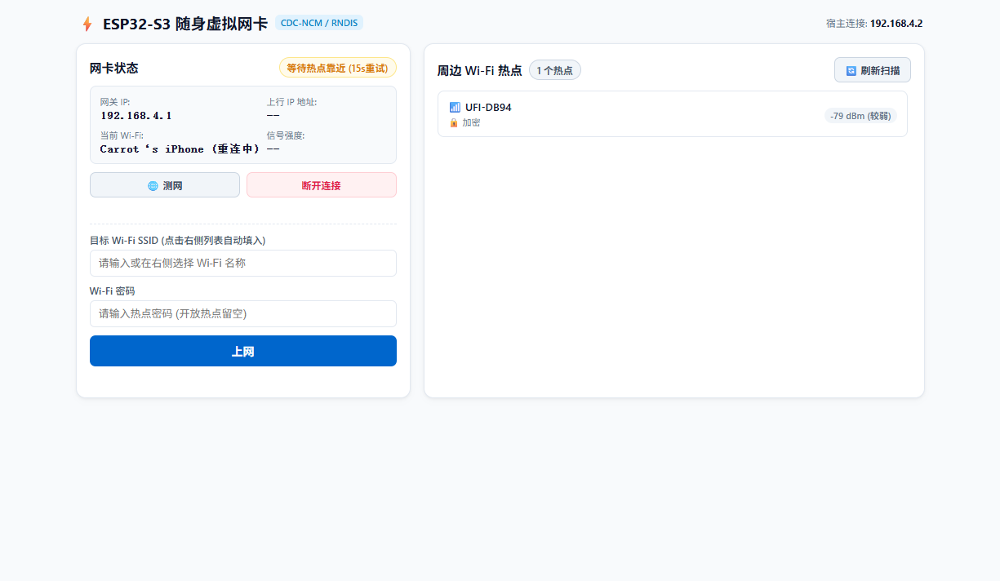
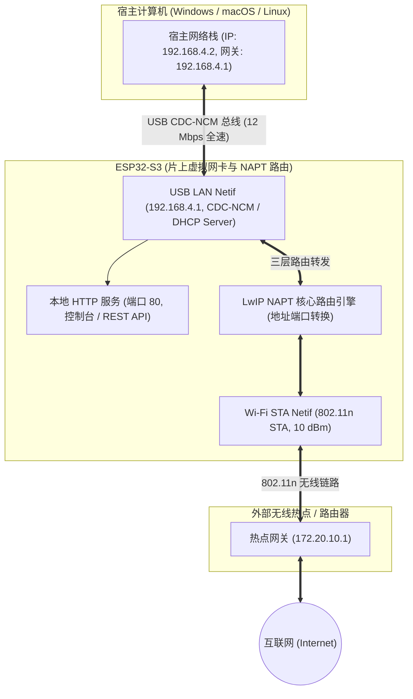

# ESP32-S3 USB 虚拟网卡 (CDC-NCM / NAPT Router)

<p align="center">
  
  
  
  
</p>

本项目基于 **ESP32-S3** 构建了一套免驱动、即插即用的便携式 USB 虚拟以太网卡与微型无线路由器。

固件利用芯片原生 USB OTG 模拟标准 USB CDC-NCM 以太网设备（全平台免驱原生识别），结合片上 Wi-Fi STA 与 **LwIP NAPT 核心网络地址与端口转换引擎**，为宿主 PC 提供稳定可靠的互联网接入，并内置轻量级 Web 控制台与 RESTful API。

---

## 📸 控制台界面

固件内置专为桌面端适配的单页响应式控制面板，支持状态监控、热点扫描、快速连接与公网测速：

<p align="center">
  
</p>

---

## ✨ 核心特性

- **全平台免驱即插即用**：遵循标准 USB CDC-NCM 规范，Windows 11 原生加载 `UsbNcm.sys`（设备名称：`Espressif Systems USB net`），macOS 与 Linux 免配置即插即用。
- **LwIP NAPT 三层网络路由**：
  - 规避 IEEE 802.11 3-地址帧限制（避免透明桥接透传 PC MAC 遭无线热点丢弃）；
  - 宿主端自动获取专用子网 IP（`192.168.4.2`），本地配置控制台（`192.168.4.1`）常驻在线；
  - 上行网络仅感知单一终端设备，有效突破移动热点连接数限制。
- **协议栈与总线吞吐调优**：
  - Wi-Fi 射频常开（`WIFI_PS_NONE`），消除 DTIM 节能休眠引发的 TCP 抖动；
  - 调优 Wi-Fi A-MPDU 聚合窗口与 LwIP TCP 接收滑动窗口；
  - 扩展 TinyUSB CDC-NCM NTB 聚合缓冲至 6.4 KB，配合 25ms 弹性重试机制实现底层传输零丢包；
  - 实测稳态吞吐达 **5.5 ~ 5.7 Mbps (约 690 ~ 710 KB/s)**（实测峰值 **5.65 Mbps / 706 KB/s**），逼近 USB 2.0 Full-Speed 架构下的物理承载极限。
- **射频功耗与供电稳定性平衡**：
  - 发射功率规范为 **10 dBm**，削减瞬态脉冲电流，峰值电流控制在 150mA 安全区间，杜绝 USB 5V VBUS 压降导致的设备复位与过热。
- **双轨故障转移与自动重连**：
  - 后台 15 秒定时器静默探测链路健康；
  - 前端扫描实时捕获目标 AP 即刻触发抢先重连，实现秒级热点找回。
- **非阻塞 TCP 公网延迟探针**：
  - 接口 `/api/test_net` 采用带超时控制的非阻塞套接字探测公共 DNS，测量实际公网 RTT（实测约 50ms），不阻塞 Web 服务主线程。

---

## 📐 网络拓扑架构



---

## 🔌 硬件与接口拓扑

| 接口/物理端口 | 芯片/角色 | 硬件引脚 | 功能说明 |
| :--- | :--- | :--- | :--- |
| **原生 USB (OTG)** | ESP32-S3 USB PHY | **GPIO19 (D-) / GPIO20 (D+)** | 数据通信通道：连接 PC 模拟 CDC-NCM 虚拟网卡与 Web 控制台。 |
| **调试串口 (UART)** | CH343 / CP2102 | **UART0 (TXD/RXD)** | 固件烧录与日志监控独立通道，运行期间与数据网卡物理隔离互不干扰。 |

> **硬件兼容性**：支持绝大多数 ESP32-S3 开发板（Flash ≥ 4MB 即可）。固件完全运行于片上 512KB SRAM，**不依赖外部 PSRAM**，无 PSRAM、Quad PSRAM (N8R2) 或 Octal PSRAM (N8R8/N16R8) 版本皆可通用。

---

## 🛠️ 快速上手

### 途径 A：使用预编译固件一键刷入（推荐，无需编译环境）

仓库内置已打包合并的完整量产固件：[`bin/esp32_ncm_factory_4MB_0x0.bin`](bin/esp32_ncm_factory_4MB_0x0.bin)（940 KB，单文件集成了引导程序、分区表与主固件）。

只需指定烧录起始地址为 **`0x0`** 即可一键刷入：

```bash
# 使用 esptool 命令行烧录（将 COMx 替换为实际调试串口，如 COM7）
esptool --chip esp32s3 -p COMx -b 921600 write-flash 0x0 bin/esp32_ncm_factory_4MB_0x0.bin
```

> **其他烧录方式**：
> - **图形工具**：打开乐鑫官方 *Flash Download Tools*，仅需在第一行载入该 bin，右侧地址输入 `0x00`，点击 Start 即可。
> - **免安装网页刷机**：支持通过 Chrome / Edge 浏览器使用 [ESP Web Tools](https://esphome.github.io/esp-web-tools/) 载入该 bin 连线直刷。

---

### 途径 B：从源码编译构建（开发者进阶）

#### 1. 环境准备
推荐使用 **ESP-IDF v6.0+** 开发环境：

```powershell
# 激活 ESP-IDF 编译工具链
. C:\Espressif\tools\Microsoft.v6.0.1.PowerShell_profile.ps1
```

#### 2. 获取源码与编译
```bash
git clone https://github.com/CRThu/esp32-ncm.git
cd esp32-ncm

# 编译固件 (配置已通过 sdkconfig.defaults 固化)
idf.py build

# 烧录并打开串口监视器 (指定调试串口号，如 COM7)
idf.py -p COM7 flash monitor
```

#### 3. 亦可手动生成单文件 Factory 固件
```powershell
esptool --chip esp32s3 merge-bin -o bin/esp32_ncm_factory_4MB_0x0.bin `
  0x0 build/bootloader/bootloader.bin `
  0x8000 build/partition_table/partition-table.bin `
  0x10000 build/esp32_ncm.bin
```

---

### 3. 上电与连接使用
1. 使用 Type-C 数据线将 ESP32-S3 **原生 USB 口** 连接至计算机；
2. 系统自动识别虚拟网卡并分配 IP 地址 `192.168.4.2`；
3. 打开浏览器访问控制台：**`http://192.168.4.1/`**；
4. 选择周围可用的 Wi-Fi 热点，输入密码后点击连接，即可连通外部网络。

---

## 📡 RESTful API 规范

ESP32-S3 提供标准的轻量级 RESTful 接口供外部系统或自动化脚本集成：

| 接口路径 | 方法 | 功能描述 | 典型响应 |
| :--- | :---: | :--- | :--- |
| `/` | `GET` | 桌面级响应式 Web 控制面板 | 完整 HTML/CSS/JS 页面 |
| `/api/status` | `GET` | 查询网卡状态、IP、RSSI、运行时间及底层传输指标 | `{"connected":true,"auto_reconnect":true,"ssid":"MyAP","ip":"172.20.10.2","rssi":-25,"tx_fails":0}` |
| `/api/scan` | `GET` | 触发并获取周边可用 AP 列表（按信号降序排列） | `[{"ssid":"MyHotspot","rssi":-22,"auth":3}]` |
| `/api/connect` | `GET` | 配置目标 SSID 与密码并发起连接 | `{"status":"connecting"}` |
| `/api/disconnect` | `GET` | 断开当前 Wi-Fi 并停用后台自动重连 | `{"status":"disconnected"}` |
| `/api/test_net` | `GET` | 触发非阻塞 TCP 探针探测公网连通性与 RTT | `{"ok":true,"rtt_ms":51}` |

---

## 🚦 多网卡环境与流量调度

当宿主计算机同时存在多块网卡（如本地局域网与本虚拟网卡）时，可通过路由策略进行灵活分流：

### 调整网卡接口跃点数 (Interface Metric)
提升本网卡路由优先级（所有公网流量优先由虚拟网卡流出）：
```powershell
# 以管理员权限运行 PowerShell
Set-NetIPInterface -InterfaceAlias "以太网 2" -InterfaceMetric 10
```

### 局部代理绕过配置
若宿主机开启了全局代理工具（如 Clash / v2ray / Mihomo），请在代理配置中排除虚拟网关网段：
```text
绕过代理名单：192.168.4.0/24, 192.168.4.1
测试命令参数：curl.exe -s --noproxy "*" http://192.168.4.1/api/status
```

---

## ❓ 技术问答 (FAQ)

<details>
<summary><b>Q1: 实测速率表现如何？为什么约为 5.5 ~ 5.7 Mbps，未能达到几十兆？</b></summary>

实测速率受工作模式与芯片物理层架构特性决定：

#### 1. 现场实测速率表现
- **当前稳态速率（射频常开 `WIFI_PS_NONE` + 10 dBm 功耗平衡）**：
  - 实测稳态下载速率：**5.5 ~ 5.7 Mbps (约 690 ~ 710 KB/s)**；
  - 实测峰值吞吐：可达 **5.65 Mbps (706 KB/s)**；
  - 底层传输表现：配合 25ms 弹性发送重试机制，实测 2MB+ 连续大包下载 **0 丢包**（`tx_fails: 0`）。
- **早期/节能模式速率（开启 Wi-Fi Modem-sleep 时）**：
  - 由于无线射频按 100ms DTIM 周期性休眠，反向 TCP ACK 确认包存在抖动，速率通常在 **3.0 ~ 3.5 Mbps (约 380 ~ 430 KB/s)**；未调优前普通模式约为 4.5 ~ 4.7 Mbps。

#### 2. 物理极限与瓶颈解析
1. **USB 2.0 Full-Speed PHY 限制**：ESP32-S3 片上内置的是 12 Mbps 全速 USB 物理层（而非 480 Mbps High-Speed），除去总线协议信令开销，理论单向最大有效载荷吞吐约为 9.6 Mbps；
2. **Bulk 事务 64 字节微包切片**：标准 1500 字节以太网 MTU 帧在 USB 传输时，必须在硬件物理层切分为 24 个 64 字节 Bulk 事务分段收发；
3. **半双工协议双向竞争**：下行数据吞吐与上行 TCP ACK 确认包共用同一条 12 Mbps 总线物理带宽；
4. 综合以上因素，**5.65 Mbps (706 KB/s)** 已经达到 12 Mbps 全速 USB 物理层约 60% 的总线有效利用率（计入双向 ACK 与 64 字节微包切片协议开销），逼近芯片物理层极值。
</details>

<details>
<summary><b>Q2: 为什么发射功率限制在 10 dBm？</b></summary>

ESP32-S3 在 20 dBm 峰值功率发射时，瞬态脉冲电流可达 450mA 以上。PC 前置 USB 接口或长线缆的内阻会导致 5V VBUS 供电轨产生瞬态跌落，诱发 USB PHY 信号失真导致系统断开连接。  
将功率约束在 10 dBm 后，射频瞬态电流下降 60% 以上，在保证正常无线覆盖的前提下，确保系统在任意供电条件下长效稳定运行。
</details>

---

## 📄 许可证

本项目遵循 [Apache License 2.0](LICENSE) 开源许可协议。
